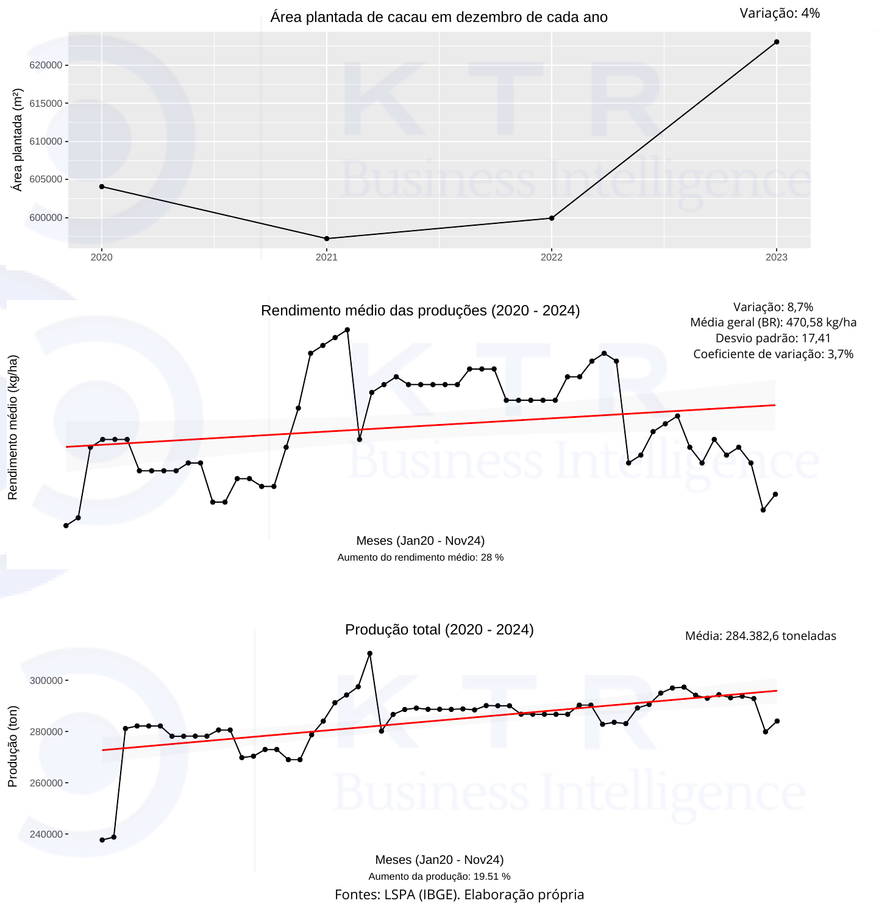
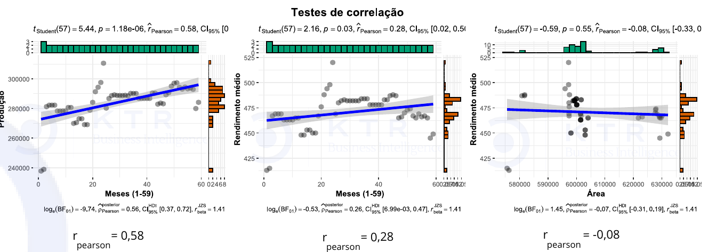
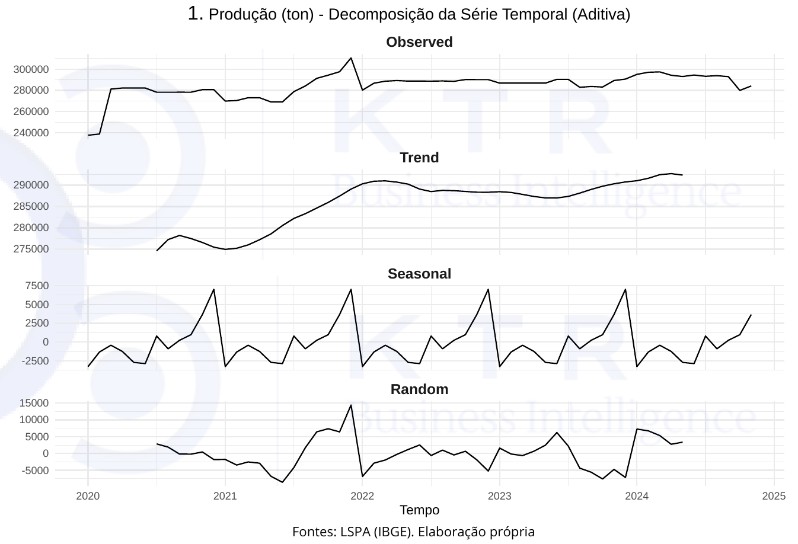
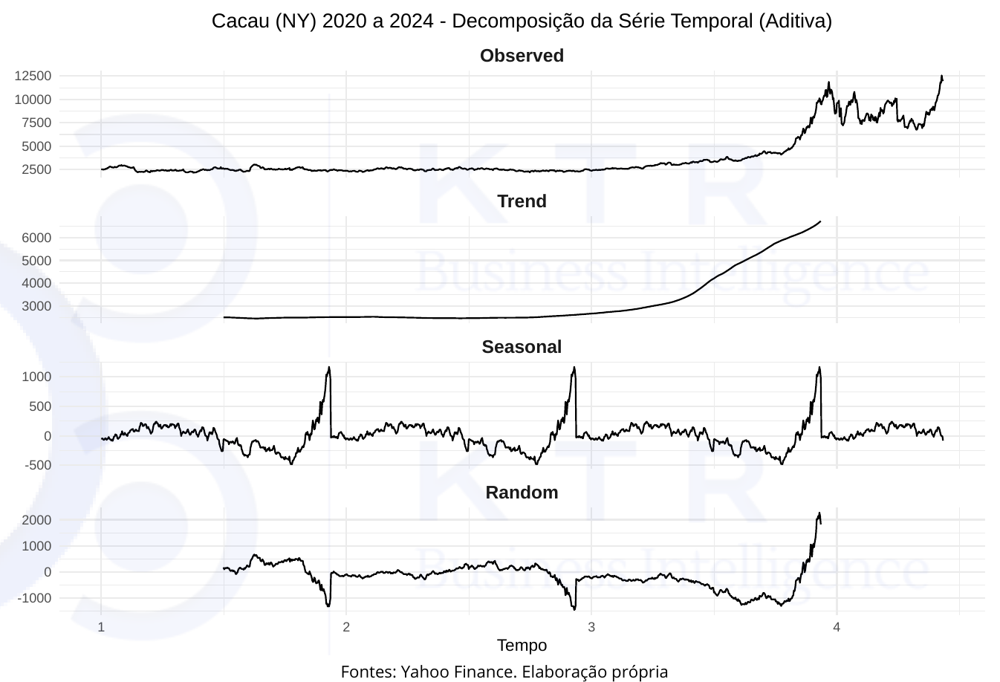
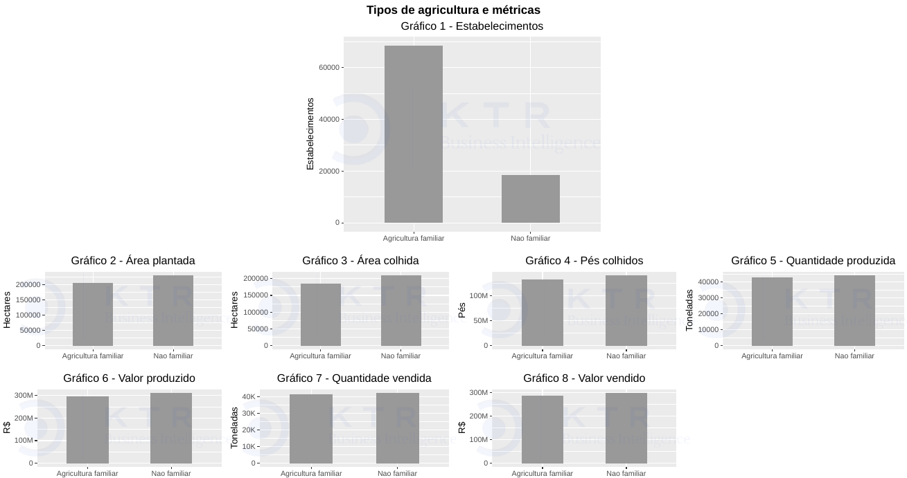

<div align="center">

# 🍫 O Cacau no Brasil: estudo de mercado orientado por dados

**Séries temporais, inferência estatística e dados públicos para entender produção, produtividade e preço de uma das commodities que mais se valorizaram em 2024**


[📄 Relatório completo (PDF)](KTR%20BI%20-%20Pesquisa%20e%20Analise%20Sobre%20o%20Mercado%20do%20Cacau%20-%202024.pdf) · [💻 Código da análise](cacau.R)

</div>

---

## Visão geral

Em 2024 o cacau passou a máxima histórica de 1977 e fechou dezembro acima de **US$ 12.500/t** na bolsa de Nova York, puxado por déficits recordes na África Ocidental. Este projeto pergunta: **o que os dados públicos dizem sobre a posição do Brasil nesse mercado?**

Integrei quatro fontes (IBGE/LSPA, Censo Agropecuário 2017, Produção Agrícola Municipal e cotações de futuros na ICE/NY) e apliquei estatística descritiva, regressão de tendência, testes de correlação e decomposição de séries temporais. O resultado é um **relatório técnico de 24 páginas** voltado para produtores e investidores, produzido pela KTR Business Intelligence.

> **Perguntas investigadas**
> 1. A produção, a área plantada e o rendimento das lavouras brasileiras estão crescendo?
> 2. Expandir a área plantada aumenta a produtividade?
> 3. Existem padrões sazonais na produção, no rendimento e no preço internacional?
> 4. Qual é o perfil dos produtores (familiar × não familiar, cooperativismo, crédito rural)?

---

## Principais resultados

| Indicador | Resultado | Período / fonte |
|---|---|---|
| Produção nacional | **+19,5%**, média de **284.383 t** | jan/2020 a nov/2024 · LSPA |
| Rendimento médio | **+8,7%**, média de **470,6 kg/ha** (σ = 17,4; CV = 3,7%) | 2020 a 2024 · LSPA |
| Área plantada | **+4%** | dez/2020 a dez/2023 · LSPA |
| Produção × tempo | **r = 0,58** (p ≈ 1,2·10⁻⁶) → tendência de alta consistente | n = 59 meses |
| Rendimento × tempo | **r = 0,28** (p = 0,03) → ganho fraco, dominado por clima e doenças | n = 59 meses |
| Rendimento × área | **r = −0,08** (p = 0,55) → **mais área não significa mais produtividade** | n = 59 meses |
| Agricultura familiar | **79%** dos estabelecimentos, mas **~49%** da produção | Censo Agro 2017 |
| Cooperativismo | apenas **2,6%** dos estabelecimentos são cooperados | Censo Agro 2017 |

**Conclusão central:** o crescimento brasileiro vem mais da **expansão de área** do que de **ganhos de produtividade**. O rendimento médio é estável (CV de 3,7%), mas sensível a choques: a decomposição mostra uma **inversão de tendência em 2023**, coincidente com o El Niño. Isso indica que tecnologia (clones resistentes à vassoura-de-bruxa, monitoramento) é a principal alavanca para o Brasil aproveitar o ciclo de preços altos.

---

## Análises em destaque

### 1. Evolução histórica e tendência linear
Área plantada, rendimento médio e produção mensal, com ajuste por mínimos quadrados (`lm`) e intervalo de confiança.



### 2. Testes de correlação de Pearson
Testes com estatística *t*, IC de 95% e fator de Bayes (`ggstatsplot`), além das distribuições marginais.



### 3. Decomposição de séries temporais
Decomposição aditiva clássica (tendência + sazonalidade + resíduo) da produção e do rendimento, complementada por ACF/PACF da série diferenciada para checar se a sazonalidade é estatisticamente significativa.



### 4. Mercado internacional
A mesma decomposição aplicada aos preços de fechamento do contrato futuro de cacau (`CC=F`, via `quantmod`/Yahoo Finance). A série foi analisada em dois recortes: 2020 a 2023, antes do choque, e 2020 a 2024, com a alta histórica.



### 5. Perfil dos produtores (Censo Agro 2017)
A agricultura familiar tem mais que o triplo de estabelecimentos, mas área, produção e valor vendido praticamente iguais aos da não familiar. Ou seja, a produção é pulverizada e o capital, pouco concentrado.



---

## Metodologia

| Etapa | Técnicas | Ferramentas |
|---|---|---|
| Coleta e limpeza | Dados do IBGE (SIDRA), tratamento de separadores de milhar, tipagem e valores ausentes, conversão para `ts` | `dplyr`, `tidyr` |
| Estatística descritiva | Média, desvio padrão, coeficiente de variação, variação percentual | R base |
| Tendência | Regressão linear simples (OLS) sobre o índice temporal | `lm`, `stat_smooth` |
| Inferência | Correlação de Pearson com teste *t*, IC 95% e fator de Bayes | `ggstatsplot` |
| Séries temporais | Decomposição aditiva clássica, diferenciação, ACF e PACF | `stats::decompose`, `acf`, `pacf` |
| Dados de mercado | Coleta automatizada de cotações e preenchimento de lacunas (LOCF) | `quantmod`, `zoo` |
| Visualização | Painéis compostos e figuras vetoriais (SVG) para o relatório | `ggplot2`, `patchwork`, `gridExtra` |

---

## Dados

| Arquivo | Conteúdo | Fonte |
|---|---|---|
| `historico_prod_cacau.CSV` | Área (ha), produção (t) e rendimento (kg/ha) mensais, 2020 a 2024 | IBGE: Levantamento Sistemático da Produção Agrícola (LSPA) |
| `Dados cacau LSPA.xlsx` | Extração bruta do LSPA com variações mensais | IBGE: LSPA |
| `comparacao_producoes_2017.CSV` | Métricas da agricultura familiar × não familiar | IBGE: Censo Agropecuário 2017 |
| `cooperativas_2017.CSV` | Métricas por associação a cooperativa | IBGE: Censo Agropecuário 2017 |
| `censo agro cacau 2017.xls` | Tabela original do Censo | IBGE: Censo Agropecuário 2017 |
| `producao_regional_bahia.csv` | Valor da produção por município baiano (R$ mil); Ilhéus lidera | IBGE: Produção Agrícola Municipal |
| *(via API)* | Cotações diárias do contrato futuro `CC=F` | Yahoo Finance |

---

## Estrutura do repositório

```
cocoa_market_research/
├── cacau.R                    # Pipeline completo: limpeza, estatística, gráficos
├── Cacau.Rproj                # Projeto RStudio
├── *.CSV / *.xlsx / *.xls     # Dados brutos e tratados (IBGE)
├── figures/                   # Figuras usadas neste README
└── KTR BI - Pesquisa e Analise Sobre o Mercado do Cacau - 2024.pdf   # Relatório final
```

---

## Limitações e próximos passos

Faz parte do trabalho deixar claro até onde a análise vai:

- **Natureza do LSPA:** os valores mensais do LSPA são *estimativas revisadas da safra anual*, não produção colhida no mês. Parte da "sazonalidade" detectada pode refletir o calendário de revisões do IBGE. O próximo passo é validar com a série anual da PAM.
- **Correlação com o tempo:** séries com tendência tendem a gerar correlações altas com o índice temporal. Testes de estacionariedade (ADF/KPSS) e de tendência não paramétricos (Mann-Kendall) dariam mais robustez.
- **Amostra curta:** 59 observações mensais limitam a estimação sazonal (menos de 5 ciclos completos).
- **Frequência da série de preços:** dados de pregão têm cerca de 252 observações por ano, não 365. Reestimar com essa frequência ou com STL robusta.
- **Evoluções planejadas:** modelos de previsão (ARIMA/ETS/Prophet) para produção e preço, correlação cruzada com defasagens entre preço e área plantada, integração de dados climáticos (precipitação e ENSO) e um relatório reprodutível em Quarto.

---

## Conhecimentos e técnicas aplicados

- **Estatística:** estatística descritiva, correlação de Pearson e testes de hipóteses.
- **Séries temporais:** decomposição clássica, análise de tendência, ACF e PACF.
- **Modelagem:** regressão linear por mínimos quadrados e inferência estatística.
- **Engenharia e análise de dados:** integração de fontes públicas, tratamento de dados e coleta de cotações via API.
- **Ferramentas:** R, tidyverse, ggplot2 e quantmod.

---

## Autores

**Gabriel Ché**: análise estatística, código em R e redação técnica
[LinkedIn](https://www.linkedin.com/in/gabriel-che) · [Portfólio](https://sites.google.com/view/gabrielch/portfolio)

**João Fenuchi**: coautor do relatório

Estudo publicado pela **KTR Business Intelligence** em dezembro de 2024.

<sub>Dados: IBGE (LSPA, PAM, Censo Agropecuário 2017), Yahoo Finance, SEI-BA. As referências completas estão na última seção do relatório.</sub>
